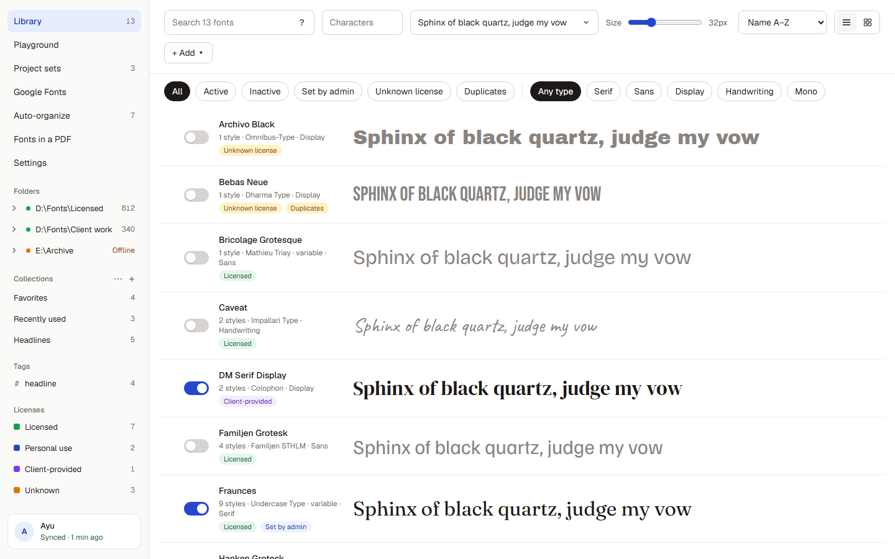
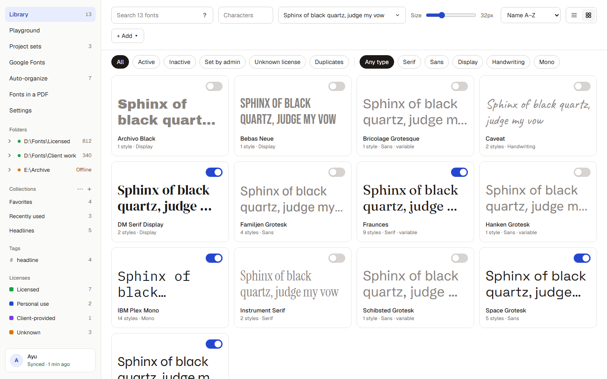
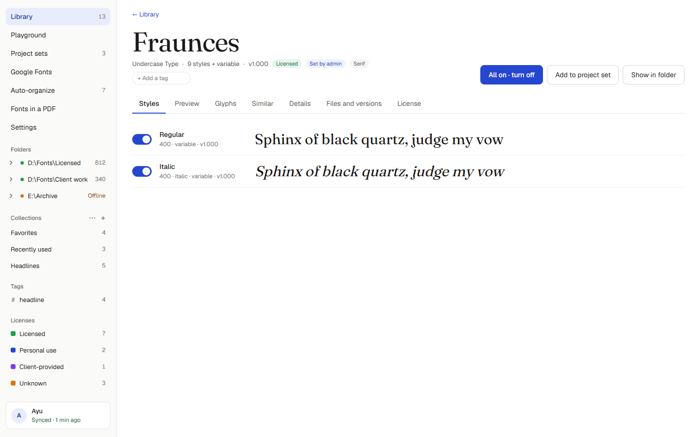
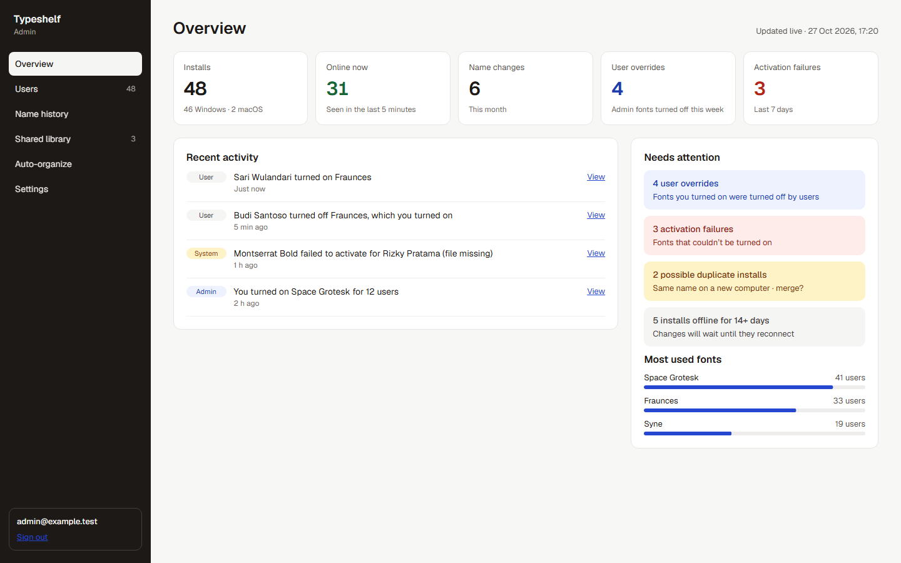
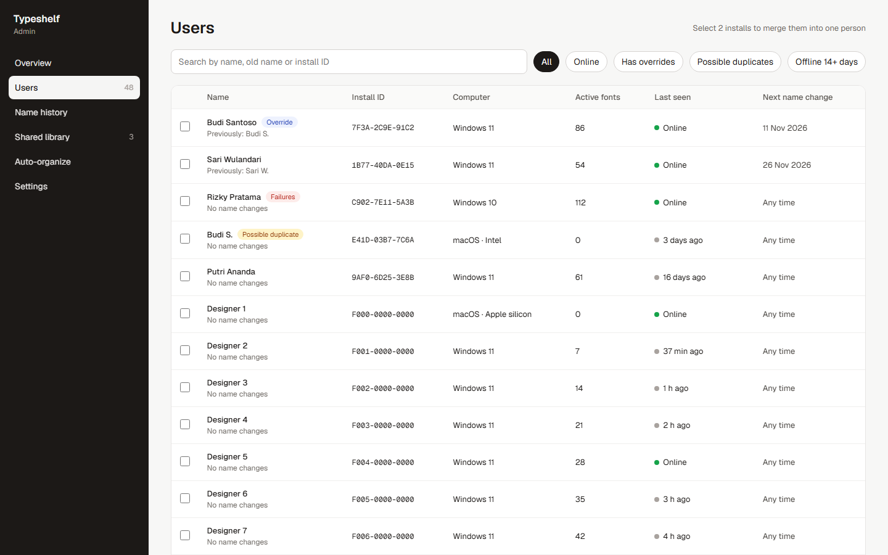
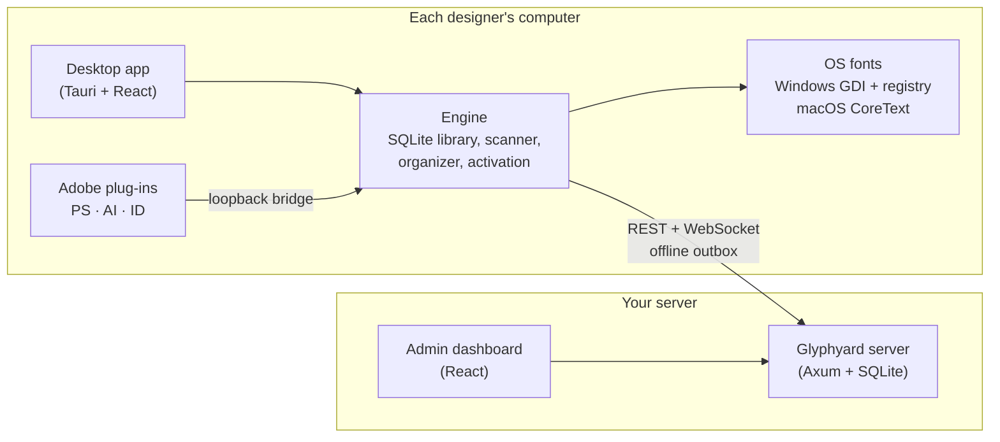

<div align="center">


# Glyphyard

**A fast font manager for Windows and macOS, with a self-hosted dashboard for the team that shares the fonts.**

No accounts, no cloud lock-in. Each designer's app reports to a server you run, and one admin keeps the whole studio's fonts in order.

<sub>Glyphyard was previously called Typeshelf; internal names (crates, binaries, folders) still use `typeshelf`.</sub>


[Features](#features) · [Screenshots](#screenshots) · [How it works](#how-it-works) · [Getting started](#getting-started) · [Docs](#documentation) · [Roadmap](#roadmap)



</div>

## Features

### Your library
- **Watched folders, as a tree.** Add a folder and every subfolder shows up. Folders that move or go offline are followed, not lost.
- **System fonts included**, read-only and always on, next to your own library.
- **Turn fonts on and off instantly.** The switch flips at once and Windows registers the fonts in the background. Hundreds of fonts take seconds, not minutes.
- **Per folder:** turn everything on or off, or **Autoactivate** so new fonts that land in a folder switch on by themselves. Folders can also be hidden.
- **Grid or list**, multi-select (Ctrl/Shift+click, Ctrl+A, Ctrl+Shift+A / D), drag fonts onto collections, and drop files or folders anywhere to import them.
- **Find anything:** categories (serif, sans, display, handwriting, mono), tags, pins, random order, a character search ("which fonts have ẞ?"), and SuperSearch tokens like `tag:headline weight:>600 foundry:"Monotype"`.

### Every family, up close
- **Styles** with an on/off switch per style, a **waterfall** preview, **glyphs** grouped by Unicode block, **OpenType features** and **variable axes**.
- **Similar** families, **details** read from the font itself (copyright, license, designer, links), files and versions, and a license label per family.
- **Rename a family** in your library without touching the font file.

### Keeping it tidy
- **Auto-organize** finds exact copies, older versions, name clashes, variable + static pairs, web fonts and junk files, shows what it will do, and can be undone.
- **Collections** with sub-collections: turn a whole collection on or off, export it as ZIP, print or save it as a PDF specimen, and export or import collections as JSON.
- **Project sets** turn a client's fonts on and off together. **Fonts in a PDF** lists what a PDF uses and turns on what you have.
- **Google Fonts** browser with one-click install, and a **Playground** for pairing type, with colours and variable axes and a Copy CSS button.

### Adobe auto-activation
- Plug-ins for **Photoshop, Illustrator and InDesign** turn on the fonts a document needs when it opens, and turn them off again when it closes.
- They install even without the Creative Cloud desktop app.

### For the admin (web dashboard)
- **Everyone's library at a glance:** each install's name history, active fonts and timeline, with a live overview.
- **Remote control:** turn fonts on or off on someone's computer, block a font everywhere, and see when a user overrides you.
- **Shared library:** upload fonts once and deliver them to one person, a few, or everyone, including people who install later.
- **Housekeeping:** merge duplicate installs, enforce the name-change interval (default 30 days), organize the shared library, and export the name history as CSV.
- **Branding:** set a studio name, an accent colour and a logo (PNG, JPEG, SVG or WebP, up to about 150 KB) in Settings. Every connected app picks them up, and the logo replaces the Glyphyard mark in the sidebar.

### Playful extras
Small surprises, all switched off by one setting (Settings › Playful extras) and quiet under reduced motion:
- **Font roulette:** click the sidebar logo five times quickly.
- **Two hidden games**, *Kern it* and *Name that font*: click the version number in Settings three times.
- **Breathing previews:** after three idle minutes, variable fonts slowly move through their weight.
- And a few more for you to find: try the Konami code, or search for `comic sans`.

Handy everywhere: Ctrl+scroll resizes a preview, Shift+scroll moves a variable font's weight, `:time`, `:date` and `:name` work in the sample text, and on a family page you can hold Space for a poster, hold Alt for glyph anatomy, or right-click a glyph to copy it as SVG.

## Screenshots

<table>
  <tr>
    <td width="50%"><p align="center"><sub>Grid view with categories and live previews</sub></p></td>
    <td width="50%"><p align="center"><sub>A family: styles, glyphs, similar, details</sub></p></td>
  </tr>
  <tr>
    <td width="50%"><p align="center"><sub>Admin overview: activity and what needs attention</sub></p></td>
    <td width="50%"><p align="center"><sub>Every install, its name history and active fonts</sub></p></td>
  </tr>
</table>

## How it works



- **No user accounts.** At first launch the app asks only for a name. The server enforces how often it can change and keeps the history.
- **Activation that repairs itself.** The app keeps a ledger of what it turned on and reconciles it with the OS at startup, so fonts don't silently disappear.
- **Works offline.** Changes queue in an outbox and sync when the server is reachable again.

## Getting started

### Requirements
- [Rust](https://rustup.rs) (stable). On Windows, Visual Studio Build Tools with "Desktop development with C++".
- [Bun](https://bun.sh)

### Run it locally
```bash
# 1. Server (first time: create an admin; it asks for a password)
cargo run -p typeshelf-server -- create-admin you@example.com --data ./data
cargo run -p typeshelf-server -- serve --port 8080 --data ./data

# 2. Admin dashboard (dev, proxies /api to :8080), or `bun run build` to serve it from the server
cd apps/admin-ui && bun install && bun run dev

# 3. Adobe plug-in packages (bundled into the desktop app)
bun plugins/build.ts

# 4. Desktop app (dev), pointed at your server
cd apps/desktop/ui && bun install && cd ../src-tauri
TYPESHELF_SERVER_URL=http://localhost:8080 TYPESHELF_INSTALL_KEY=<key from admin Settings> bunx @tauri-apps/cli dev
```

> [!TIP]
> Both UIs also run in a plain browser with sample data, with no server needed: `bun run dev` in `apps/desktop/ui`, or the admin with `?mock=1`.

### Build the Windows installer
```powershell
cargo run -p typeshelf-server -- install-key --data ./data   # the key the apps will carry
./scripts/build-windows.ps1 -ServerUrl https://fonts.example.com -InstallKey <key>
```
This produces `dist/Glyphyard-Setup-<version>.exe`, a custom installer ([docs/setup.md](docs/setup.md)) with these properties:
- **Install:** per-user, with no admin prompt. The server URL and install key are compiled in, and the Adobe plug-in packages are bundled.
- **Update and uninstall:** it updates an existing install in place. It is also the uninstaller, which turns off every font Glyphyard registered.
- **Silent install:** `Glyphyard-Setup.exe --silent [--dir <path>] [--desktop]`.

> [!NOTE]
> The installer isn't code-signed yet, so Windows SmartScreen shows **More info → Run anyway**. If you regenerate the install key on the server, rebuild the installer.

### Deploy the server
The server is one binary plus a data folder. Run it as a systemd service behind an HTTPS reverse proxy; [docs/deploy.md](docs/deploy.md) walks through the setup.

## Repository layout

| Path | What's inside |
|---|---|
| `crates/core` | Font parsing, metrics and categories, glyph coverage, the auto-organize planner, the name rule |
| `crates/engine` | Desktop backend: library database, scanning and watching, activation ledger, organize, search, collections, PDF, Google Fonts, backup |
| `crates/activation` | OS font activation (Windows registry + GDI, macOS CoreText) and repair |
| `crates/sync` | Desktop ↔ server client: REST, WebSocket, offline outbox |
| `crates/protocol` | Messages shared by the desktop app and the server |
| `crates/adobe-bridge` | Loopback bridge for the Adobe plug-ins, and plug-in install/remove |
| `apps/desktop` | The Tauri app (`src-tauri`) and its React UI (`ui`) |
| `apps/setup` | The custom Windows installer |
| `apps/server` | The admin server (Axum + SQLite); it also serves the dashboard |
| `apps/admin-ui` | The admin dashboard (React) |
| `plugins` | Photoshop/InDesign (UXP) and CEP plug-ins |

## Development

```bash
cargo test --workspace
cargo clippy --workspace --all-targets -- -D warnings
cd apps/desktop/ui && bunx tsc --noEmit -p tsconfig.app.json
cd apps/admin-ui && bunx tsc --noEmit -p tsconfig.app.json
```

## Documentation

| Document | About |
|---|---|
| [docs/design.md](docs/design.md) | What Glyphyard is, its goals, and the design decisions |
| [docs/desktop-commands.md](docs/desktop-commands.md) | Every command and event between the desktop UI and its backend |
| [docs/api.md](docs/api.md) | The server's HTTP and WebSocket API |
| [docs/setup.md](docs/setup.md) | The Windows installer |
| [docs/deploy.md](docs/deploy.md) | Running the server |
| [plugins/README.md](plugins/README.md) | The Adobe plug-ins and how they talk to the app |

## Roadmap

- [x] Library, folders, activation, collections, tags, project sets
- [x] Auto-organize with undo
- [x] Admin dashboard: name history, remote control, shared library
- [x] Adobe auto-activation plug-ins
- [x] Instant on/off with background registration
- [ ] macOS universal `.dmg` (needs a Mac to build; unsigned without an Apple Developer account)
- [ ] Code signing for the Windows installer
- [ ] Auto-updater
- [ ] Testing the plug-ins in every Adobe version, and the macOS build on real hardware

## Acknowledgements

Built with [Tauri](https://tauri.app), [Axum](https://github.com/tokio-rs/axum), [SQLite](https://sqlite.org), [skrifa](https://github.com/googlefonts/fontations) and [React](https://react.dev).

## License

Glyphyard is free software under the [GNU Affero General Public License v3.0](LICENSE). You can use, change and share it. If you run a modified version for other people, including as a hosted service, you must share your changes under the same license.

**Commercial license:** if the AGPL doesn't suit your organisation, for example because you want to ship a closed-source fork or a hosted offering, a commercial license is available. Contact the maintainer through GitHub.

**Contributing:** contributions are welcome. Because Glyphyard is also offered under a commercial license, pull requests are accepted only after you agree that your contribution may be distributed under both the AGPL and the commercial license.

"Glyphyard" and its logo are not covered by the license; please don't use them for your own fork.
